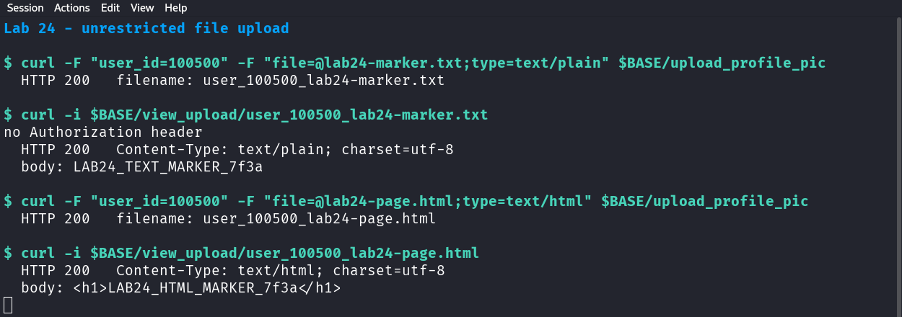

# 24 — Unrestricted file upload

*Can Devom store and serve a file it should have rejected?*

## What this lab does

You will upload a harmless text file as a profile picture, retrieve it by the filename the server returns, and then upload a small HTML file the same way. The lab checks two things: whether the server validates the file type, and whether the stored file can be read without an authenticated session.

A text file and an HTML file are not executable code. Storing them shows missing validation and missing access control; it does not show code execution.

**Target:** Devom at revision [`af4290ce8d2178765bfc2bd96cf233f6d3d03161`](https://github.com/memohk/Devom/tree/af4290ce8d2178765bfc2bd96cf233f6d3d03161). **Tested** on 29 October 2026 against the pinned revision running on loopback (Python 3.14, Flask 3.1.3). The results below show what this walkthrough produces on that setup.

## Before you begin

Complete [Common prerequisites](00-common-setup.md) and [Devom setup](01-devom-setup.md). Use the seeded `cala` account and the disposable `uploads/` directory inside the checkout.

Do not upload an executable, a script, a real photo, or personal data. Keep the test files under a few kilobytes and give them unique names so you do not overwrite anything.

## Tools needed

- The running Devom backend from [Devom setup](01-devom-setup.md).
- Bash and `curl`.

The upload and retrieval endpoints are exempt from Devom's response encryption, so `User-Agent` does not matter here.

## Guided walkthrough

### 1. Create the test files

```bash title="Create a text file and a small HTML file"
BASE='https://127.0.0.1:8080'
printf 'LAB24_TEXT_MARKER_7f3a\n' > lab24-marker.txt
printf '<h1>LAB24_HTML_MARKER_7f3a</h1>\n' > lab24-page.html
ls -l lab24-marker.txt lab24-page.html
```

!!! success "Expected"
    Both files exist and are a few dozen bytes. The HTML file contains no script, only a heading.

### 2. Upload the text file as a profile picture

```bash title="Upload the text file"
curl --insecure -i -F 'user_id=100500' \
  -F 'file=@lab24-marker.txt;type=text/plain' "$BASE/upload_profile_pic"
```

!!! success "Expected"
    `HTTP/1.1 200 OK` with `{"status": "success", "filename": "user_100500_lab24-marker.txt", "server_debug": "Processing file: user_100500_lab24-marker.txt\n"}`.

The upload was accepted even though it is not an image. The server prefixes the name with `user_<user_id>_` and keeps your extension.

### 3. Retrieve the file without a session

```bash title="Read the uploaded file back"
curl --insecure -i "$BASE/view_upload/user_100500_lab24-marker.txt"
```

!!! success "Expected"
    `HTTP/1.1 200 OK`, `Content-Type: text/plain`, and the body `LAB24_TEXT_MARKER_7f3a`.

Notice what the request did **not** include: an `Authorization` header, a token, or any claim to be `cala`. The file is served to anyone who knows the URL.

### 4. Upload the HTML file and retrieve it

```bash title="Upload the HTML file"
curl --insecure -i -F 'user_id=100500' \
  -F 'file=@lab24-page.html;type=text/html' "$BASE/upload_profile_pic"
```

!!! success "Expected"
    `HTTP/1.1 200 OK` with `"filename": "user_100500_lab24-page.html"`.

```bash title="Read the HTML file back"
curl --insecure -i "$BASE/view_upload/user_100500_lab24-page.html"
```

!!! success "Expected"
    `HTTP/1.1 200 OK`, `Content-Type: text/html`, and the `<h1>` line as the body.



Both uploads returned `200` and both retrievals returned `200` without an `Authorization` header: the text file as `text/plain`, the HTML file as `text/html`.

!!! important "Key observation"
    The text and HTML files were both accepted, and both were retrievable without an authorization header. This demonstrates missing type validation and unauthenticated retrieval for these test files; it does not demonstrate code execution or access to another user's file.

The server chooses the content type from the file extension, so the same origin will render this file as a page. That is why the lab uses a heading and no script: the point is that the type was not checked, not that anything executes.

### 5. Compare the checks in the handler

Open `server.py` and read `upload_profile_pic` and `view_upload`. In this revision:

- The handler checks only that a `file` part exists. It does not check the extension, the declared MIME type, the file's contents, or the size.
- The stored name is `user_<uid>_<original filename>`, and `file.save()` writes it under `uploads/`.
- `view_upload` calls `send_file(os.path.join(UPLOAD_FOLDER, filename))` with no authentication and no ownership check.

### 6. State what the result proves

- Uploading and retrieving a text or HTML file shows missing type validation and missing access control on retrieval.
- It does not show code execution, a web shell, or access to another user's private file.
- The filename includes the user ID, so two users uploading `photo.jpg` do not collide. That is a naming convenience, not an authorization check.

## Troubleshooting

- **`400` with `{"status": "error"}`:** the `file` part is missing. Keep the `-F` field name exactly `file`.
- **`404` when retrieving:** use the `filename` value from the upload response, not your local filename.
- **The response shows a different content type:** the server derives it from the extension. Rename the local file rather than setting `type=` alone if you need a different type.
- **`curl` reports a certificate error:** keep `--insecure` for this loopback request only.
- **The upload succeeds but `profile_pic` is unchanged:** the filename contains `kyc` or `identity`, which this revision treats as KYC data. Avoid those words in test filenames.

<details markdown="1">
<summary>Hints</summary>

1. Compare the extension, the multipart `type=`, and what the server actually stored.
2. `send_file` guesses the response content type from the filename.
3. `view_upload` has no `@token_required` decorator and no ownership lookup.

</details>

## Evidence

Submit these four items:

- **Upload responses:** the status and returned `filename` for both files.
- **Retrieval responses:** the status, `Content-Type`, and body for both files, with the requests shown to have no `Authorization` header.
- **Handler note:** one or two sentences quoting the missing checks in `upload_profile_pic` and `view_upload`.
- **Limits:** state that the files were text and HTML, that nothing executed, and that no other user's file was accessed.

## Vulnerability and Impact

Devom stores any file a client sends and serves it back from `/view_upload` without authentication. In the inspected revision there is no extension allowlist, no content inspection, and no ownership check on retrieval. The naming scheme uses the user ID to avoid collisions but does not decide who may read the result.

The practical impact is that an unauthenticated visitor can read uploaded identity documents and profile pictures if the filename is known, and the server will serve learner-supplied HTML from its own origin. The filename is predictable enough that a user ID plus a guessed name narrows the search. This lab does not demonstrate code execution or a path traversal; Lab 25 covers reading outside the uploads directory.

## Cleanup and review

- Remove the local test files: `rm -f lab24-marker.txt lab24-page.html`.
- Leave the two uploaded copies in `uploads/` for the lab reset, or delete only `user_100500_lab24-marker.txt` and `user_100500_lab24-page.html` if your lab policy allows it.
- `cala`'s `profile_pic` column now points at the last upload. Note it in your report; later labs do not depend on it.

Where should the type check happen, where should the access check happen, and why should uploaded content be stored and served from a location that cannot execute or render application code?
