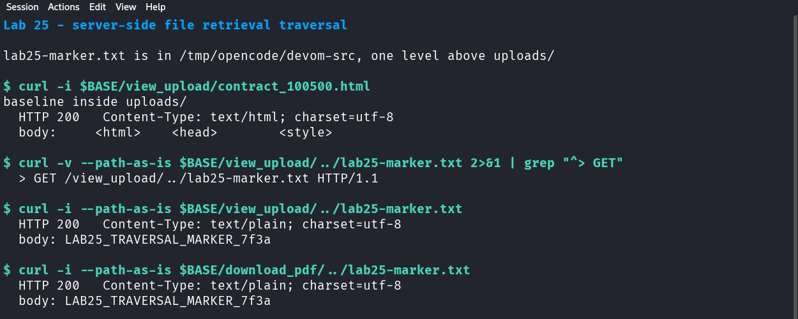

# 25 — Server-side file retrieval traversal

*Can `/view_upload` read a file from outside the uploads directory?*

## What this lab does

You will place one harmless marker file next to `server.py`, outside Devom's `uploads/` directory. Then you will retrieve a normal upload first and the marker second, using the same endpoint, and compare the two responses.

If the second request returns the marker, the endpoint joined the requested path onto the uploads directory without checking that the result stayed inside it. Only the marker file is in scope.

**Target:** Devom at revision [`af4290ce8d2178765bfc2bd96cf233f6d3d03161`](https://github.com/memohk/Devom/tree/af4290ce8d2178765bfc2bd96cf233f6d3d03161). **Piloted** on 29 October 2026 against the pinned revision running on loopback (Python 3.14, Flask 3.1.3). The results below were observed in that run.

## Before you begin

Complete [Common prerequisites](00-common-setup.md) and [Devom setup](01-devom-setup.md). Create the marker yourself in the Devom checkout, so the lab does not depend on an instructor-supplied file.

Request only `lab25-marker.txt`. Do not request the SQLite database, the JWT key files, the server source, or anything outside the checkout. Those files exist beside the marker, and reading them is out of scope for this lab.

## Tools needed

- The running Devom backend and a terminal in the Devom checkout.
- Bash and `curl`. The `--path-as-is` option matters: without it, curl collapses `..` before sending the request.

## Guided walkthrough

### 1. Create the marker outside the uploads directory

Run this in the Devom checkout, the same directory that contains `server.py` and `uploads/`:

```bash title="Create the marker next to server.py"
printf 'LAB25_TRAVERSAL_MARKER_7f3a\n' > lab25-marker.txt
pwd
ls -l lab25-marker.txt
ls -d uploads
```

!!! success "Expected"
    `pwd` prints the Devom checkout, `ls -l` shows `lab25-marker.txt` in that directory, and `ls -d uploads` confirms the uploads directory is a sibling. The marker is one level above `uploads/`.

### 2. Retrieve a normal file (baseline)

Devom generates a contract file for each seeded user at first start. Retrieve `cala`'s contract:

```bash title="Normal retrieval inside uploads"
BASE='https://127.0.0.1:8080'
curl --insecure -i "$BASE/view_upload/contract_100500.html"
```

!!! success "Expected"
    `HTTP/1.1 200 OK` with an HTML contract for `cala`. The request carried no `Authorization` header.

If the contract is missing, upload a small file from Lab 24 first and use its returned filename instead.

### 3. Request the marker through the same endpoint

```bash title="Traversal one level up"
curl --insecure -i --path-as-is "$BASE/view_upload/../lab25-marker.txt"
```

!!! success "Expected"
    `HTTP/1.1 200 OK` and the body `LAB25_TRAVERSAL_MARKER_7f3a`.

The path segment `../` moved the resolved path from `uploads/` to its parent, which is the checkout that also contains `server.py` and `usersdb/`.

### 4. Try the second endpoint

`/download_pdf` uses the same `os.path.join` pattern:

```bash title="The same traversal through download_pdf"
curl --insecure -i --path-as-is "$BASE/download_pdf/../lab25-marker.txt"
```

!!! success "Expected"
    `HTTP/1.1 200 OK` with the same marker. Two endpoints share the flaw.



In the pilot, both endpoints returned `200` with `LAB25_TRAVERSAL_MARKER_7f3a`. The same request without `--path-as-is` returned `404`, because curl removed `../` before sending it.

### 5. Confirm the request that reached the server

If either request returned `404` or the contract instead of the marker, look at what curl actually sent:

```bash title="Show the raw request line"
curl --insecure -v --path-as-is "$BASE/view_upload/../lab25-marker.txt" 2>&1 | grep -E '^(> GET|< HTTP|< Content-Type)'
```

The `> GET` line must still contain `/view_upload/../lab25-marker.txt`. If it shows `/lab25-marker.txt`, the client normalized the path and the test did not exercise the server.

### 6. Decide what the result proves

- A `200` with the marker shows that the requested path escaped `uploads/`.
- The endpoint has no containment check: it builds `os.path.join(UPLOAD_FOLDER, filename)` and passes the result to `send_file`.
- Retrieving the marker does not show which other files are readable. That is a follow-on question for a scoped test, not part of this lab.

## Troubleshooting

- **`404` for the marker:** confirm the marker sits directly beside `uploads/`, not inside it. `../lab25-marker.txt` is exactly one level up.
- **The server returns the uploads directory listing or an error page:** record the actual response; the endpoint expects a file, not a directory.
- **The request line lost its `../`:** add `--path-as-is`. A proxy between you and the server may still normalize; check with the `-v` command in Step 5.
- **`403` or `401`:** this revision serves `/view_upload` without authentication. If you see a refusal, you are not talking to the lab instance.
- **The contract file is absent:** the database may have been created before contracts were generated. Use a Lab 24 upload as the baseline instead.

<details markdown="1">
<summary>Hints</summary>

1. Compare a path inside `uploads/` with a path that starts with `../`.
2. `os.path.join(UPLOAD_FOLDER, filename)` does not resolve or compare the final path against `UPLOAD_FOLDER`.
3. `send_from_directory` performs that containment check; `send_file` does not.

</details>

## Evidence

Submit these four items:

- **Baseline:** the request path and status for the normal contract or upload retrieval.
- **Traversal:** the exact request path, status, and the marker body for both endpoints.
- **Raw request:** the `> GET` line from Step 5, showing that `../` reached the server.
- **Limits:** state that only `lab25-marker.txt` was requested, and that no database, key, or source file was read.

## Vulnerability and Impact

`/view_upload/<path:filename>` and `/download_pdf/<path:filename>` join the client-supplied path onto the uploads directory and pass the result to `send_file`. `os.path.join` happily walks upward, and `send_file` serves whatever file the joined path names, without authentication.

The impact is arbitrary file disclosure from any path the web server can read. Next to `uploads/` in this checkout are `usersdb/usuarios.db` with every account and `jwt_keys/prod.key` with the token-signing key, so a real deployment of this code could leak its entire user database and the key that mints sessions. This lab confirms only that the boundary was crossed.

## Cleanup and review

- Remove the marker: `rm -f lab25-marker.txt`.
- Remove any files you created for the baseline.
- Leave the Devom database and generated contracts in place.

Why is joining two paths not enough to confine a file read? What check would you add, and why must it compare canonical paths rather than the original string?
