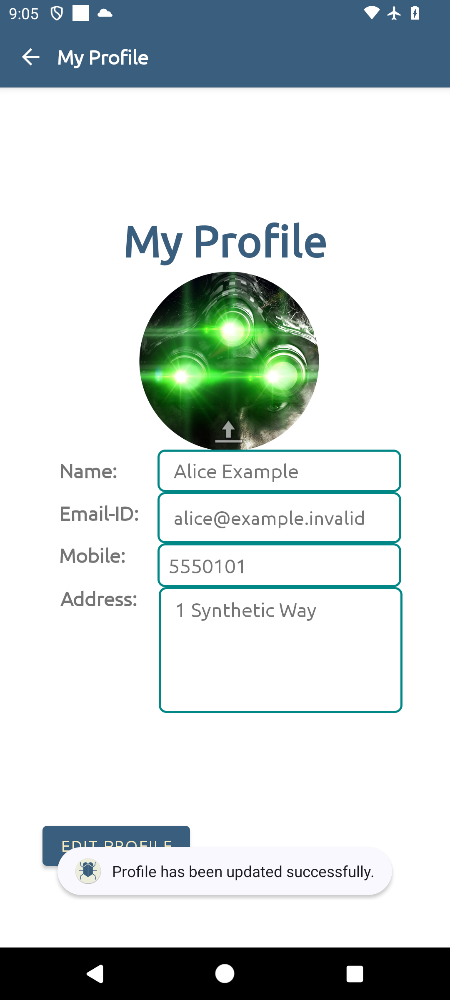

# 27 — Cloud storage misconfiguration

*Can a client read a stored user record without any credentials?*

!!! danger "Use only the local emulator in a disposable lab"
    This lab runs entirely against the repository's Firebase Storage emulator on the host loopback interface. Do not point the app at a cloud project, reuse any key from the APK, or expose the emulator ports beyond the disposable lab. The committed rules are deliberately open for the exercise and must never be deployed to a real project.

## Scenario

BugBazaar saves profile details to Firebase Storage as a text object. You are reviewing whether the storage service protects that object independently of the app's login and passcode. Use the separate Lab 27 app, synthetic profiles and the local Storage emulator; the upstream cloud project is out of scope.

## Goal

You will:

1. Start the local Storage emulator and confirm its synthetic baseline.
2. Read a seeded object without credentials.
3. Verify the local APK/configuration identity before saving a synthetic profile in the app.
4. Find the app-written object and read it without credentials.
5. Compare the read result with the local Storage rule.

**Verification status:** verified end to end on 2 November 2026 on Android 14 / API 34 with the published APK. The outputs below are from that run.

**Target:** the bundled `bugbazaar-lab27-emulator.apk` (package `com.BugBazaar.lab27`), built from BugBazaar source revision [`fef6a899a684245eb70b2ab4be926f62be849ed9`](https://github.com/payatu/BugBazaar/tree/fef6a899a684245eb70b2ab4be926f62be849ed9). Complete [Common prerequisites](00-common-setup.md) and [BugBazaar setup](02-bugbazaar-setup.md), including its Lab 27 install section.

## Before you begin

### Tools needed

- A prepared workspace with the emulator configuration, synthetic fixtures and lifecycle scripts under `lab27/`, from the archive or repository path in Common prerequisites.
- Firebase CLI `15.34.2`, Storage runtime `1.1.3` and emulator UI `1.15.0`, already included in the download. Only the repository-only path needs the [independent Firebase tooling steps](00-common-setup.md#lab-27-firebase-tooling).
- `curl` and `python3` on the host, for the object reads and JSON formatting.
- An Android emulator with ADB access and a route to the host alias `10.0.2.2`.
- The Lab 27 APK bundled in the LabKit and installed with `./install-apk.sh bugbazaar-lab27-emulator.apk`.

If you use the verified download, skip the all-lab bootstrap and start with Step 1 after installing the variant. No separate Lab 27 tool, runtime or support-file download is needed. The walkthrough says "extracted LabKit directory" for its command location; if you prepared independently, use your workspace root instead. Both paths provide the `lab27/` and `apk/` layout. The scripts select the bundled `lab27/emulators/` cache or the independent `.labkit/home` cache automatically.

The bundled standalone CLI and the included npm lock both pin Firebase CLI `15.34.2`. The APK build used Gradle 8.4, Android Gradle plugin 8.3.1, NDK 26.1.10909125 and OpenJDK 21.0.12.1; you do not need those build tools to run the lab.

Keep host egress restricted to the loopback path used here. The emulator must be able to reach the host; confirm that the approved firewall allows `127.0.0.1:9199` and `127.0.0.1:4000` from the lab boundary and blocks unrelated egress. Do not expose either port to a LAN or the internet.

## Understand the scenario

Firebase Storage protects objects with rules evaluated by the storage service, not by the Android UI. The app uploads with its own configuration and does not sign the user in to Firebase. The committed rule for this lab allows every read and write:

```text
match /{allPaths=**} {
  allow read, write: if true;
}
```

Anyone who can reach the emulator can read or write the object under this rule. The app still asks for a login and a device passcode, but those local controls do not protect the Storage object. Signing in gets you to the profile screen. The unauthenticated `curl` request tests whether the storage service itself restricts access.

## Guided walkthrough

### 1. Start the emulator and confirm the baseline

**Where:** host shell, extracted LabKit directory.

`reset.sh` stops any running instance, clears the emulator's runtime state, starts it, and uploads the fixtures:

```bash title="01 · Reset, start, and seed the local emulator"
./lab27/reset.sh
```

Expected output from the verified run:

```text
Lab 27 emulator stopped.
Lab 27 Storage emulator is ready at http://127.0.0.1:9199
Emulator UI: http://127.0.0.1:4000
Seeded alice-lab27%2Fuserinfo.txt
Seeded bob-lab27%2Fuserinfo.txt
```

The expanded download also prints SHA-256 `OK` checks for its bundled CLI, Storage runtime and UI before the readiness lines. The app and API outputs below remain from the verified Android run; the expanded bundle's host service was separately checked with external networking unavailable.

List the objects:

```bash title="02 · List the baseline objects"
curl -fsS 'http://127.0.0.1:9199/v0/b/lab27-local.appspot.com/o' \
  | python3 -m json.tool
```

Expected: two items, both in bucket `lab27-local.appspot.com`:

```json
{
    "prefixes": [],
    "items": [
        {
            "name": "alice-lab27/userinfo.txt",
            "bucket": "lab27-local.appspot.com"
        },
        {
            "name": "bob-lab27/userinfo.txt",
            "bucket": "lab27-local.appspot.com"
        }
    ]
}
```

**Check:** the bucket identifier is `lab27-local.appspot.com`, not an upstream project. If the command fails, stop and use the troubleshooting section; do not continue with an unknown backend.

### 2. Read a seeded record without credentials

**Where:** host shell, extracted LabKit directory.

The URL path encodes `/` as `%2F`. `alt=media` asks the Storage API for the object bytes instead of metadata.

```bash title="03 · Unauthenticated read of the seeded record"
curl -fsS \
  'http://127.0.0.1:9199/v0/b/lab27-local.appspot.com/o/alice-lab27%2Fuserinfo.txt?alt=media'
```

Expected output from the verified run:

```text
Name: Alice Example
Email: alice@example.invalid
Mobile: 555-0101
Address: 1 Synthetic Way
Marker: LAB27-ALICE-SYNTHETIC
```

**Check:** the command sends no `Authorization` header and still returns the record. This is the lower-privilege baseline.

### 3. Confirm the app and configuration are local

**Where:** host shell, extracted LabKit directory.

Verify the published APK you installed:

```bash title="04 · Verify the Lab 27 APK identity"
printf '%s  %s\n' \
  b3f0249634f7bc401fb79c43eb7f6093a030501b4d36a7e0c05864cbb8041604 \
  apk/bugbazaar-lab27-emulator.apk | sha256sum --check -
adb shell pm path com.BugBazaar.lab27
```

Expected: `OK`, followed by a package path such as `package:/data/app/.../base.apk`.

Read the committed identifiers:

```bash title="05 · Show the local project identifiers"
grep -E '"project_id"|"storage_bucket"|"package_name"' \
  lab27/google-services.json
```

Expected output:

```text
    "project_id": "lab27-local",
    "storage_bucket": "lab27-local.appspot.com",
          "package_name": "com.BugBazaar.lab27",
```

**Check:** the package is `com.BugBazaar.lab27` and both Firebase identifiers are local. The APK hash ties the installed file to this configuration and to the `10.0.2.2:9199` endpoint in the variant built from the pinned source.

### 4. Sign in and open My Profile

**Where:** the Android emulator.

Complete [BugBazaar setup](02-bugbazaar-setup.md#4-install-the-lab-27-variant) first if the app is not installed. Then:

1. Launch **BugBazaar Lab 27**.
2. Sign in with the lab-only credentials `admin` / `BugBazaarSeccool`.
3. Create a four-digit passcode of your choice. Use `1234` for this walkthrough.
4. Deny the media, SMS, and notification permission prompts. They are not needed.
5. If a promotional dialog or a **No Internet Access** dialog appears, choose **OK**.
6. Tap the menu icon, then **My Profile**.

**Check:** the profile screen shows `Name:`, `Email-ID:`, `Mobile:`, and `Address:` with the app's demo values.

### 5. Save a synthetic profile

**Where:** the Android emulator, **My Profile** screen.

1. Tap **EDIT PROFILE**.
2. Replace the fields with these synthetic values:
   - Name: `Alice Example`
   - Email-ID: `alice@example.invalid`
   - Mobile: `5550101`
   - Address: `1 Synthetic Way`
3. Tap **SAVE PROFILE**.

**Check:** the screen returns to the read-only view and shows the values you entered. The app also writes `userinfo.txt` to its configured bucket; the next step confirms that write.

[{ .phone-evidence }](images/lab-27/profile-saved.png "Open full-size screenshot")

The captured app screen shows the synthetic profile and `Profile has been updated successfully.` The next step verifies the device-named object in the local Storage emulator.

Use only these synthetic values. Do not enter a real address, phone number, or email.

### 6. Confirm the app-written object

**Where:** host shell, extracted LabKit directory.

```bash title="06 · List objects after the app save"
curl -fsS 'http://127.0.0.1:9199/v0/b/lab27-local.appspot.com/o' \
  | python3 -m json.tool
```

Expected: the two seeded objects plus a new object whose prefix is the emulator's device name. The verified run produced:

```json
{
    "prefixes": [],
    "items": [
        {
            "name": "Google sdk_gphone64_x86_64/userinfo.txt",
            "bucket": "lab27-local.appspot.com"
        },
        {
            "name": "alice-lab27/userinfo.txt",
            "bucket": "lab27-local.appspot.com"
        },
        {
            "name": "bob-lab27/userinfo.txt",
            "bucket": "lab27-local.appspot.com"
        }
    ]
}
```

**Check:** a new `<device-name>/userinfo.txt` object exists. The prefix is built from the emulator's manufacturer and model, so yours may differ. Use the exact name from your list in the next step.

If the object is missing, see the troubleshooting section before changing anything.

### 7. Read the app-written object without credentials

**Where:** host shell, extracted LabKit directory.

Substitute your object prefix. In the verified run it was `Google sdk_gphone64_x86_64`, and the space is encoded as `%20`:

```bash title="07 · Unauthenticated read of the app-written record"
curl -fsS \
  'http://127.0.0.1:9199/v0/b/lab27-local.appspot.com/o/Google%20sdk_gphone64_x86_64%2Fuserinfo.txt?alt=media'
```

Expected output from the verified run:

```text
Name: Alice Example
Email: alice@example.invalid
Mobile: 5550101
Address: 1 Synthetic Way
```

**Check:** the values you entered in the app come back with no credentials. This is the demonstrated exposure.

### 8. Compare the result with the deployed rule

**Where:** host shell, extracted LabKit directory.

```bash title="08 · Show the committed Storage rule"
sed -n '1,20p' lab27/storage.rules
```

Expected: the `match /{allPaths=**}` block contains `allow read, write: if true;`.

**Check:** the rule that permits your unauthenticated read matches the rule committed in the repository. Include both the response and the rule text in your finding to show the exposure and the configuration that explains it.

!!! important "Key observation"
    The app's login and passcode are local UI controls. The Storage rule is the actual boundary, and here it allows any client that can reach the emulator to read and write every object. The finding needs both parts: the unauthenticated read and the permissive rule that explains it. This lab demonstrates the configuration on a synthetic local emulator; it does not test an upstream project.

## Troubleshooting

- **`reset.sh` cannot start the emulator:** check that ports `9199` and `4000` are free, run `./lab27/stop.sh`, then retry. If it still fails, read `lab27/.runtime/emulator.log`.
- **The app shows network errors or the object never appears:** confirm the emulator has a route to the host alias `10.0.2.2` and that the approved firewall allows loopback port `9199`. Then restart the app and save again. Inspect app logs with `adb logcat --pid=$(adb shell pidof com.BugBazaar.lab27)`.
- **The object prefix differs from the example:** use the exact prefix from your object list. The prefix is the emulator's manufacturer and model, not a fixed value.
- **The app is already installed with a different signature:** the Lab 27 variant has its own package. If `com.BugBazaar.lab27` is present but not yours, use a fresh disposable emulator; do not uninstall the official `com.BugBazaar`.
- **The passcode is unknown:** app state is disposable. Use a fresh emulator, or clear only `com.BugBazaar.lab27` with `adb shell pm clear com.BugBazaar.lab27`. Never clear the official app.
- **Permission prompts keep appearing:** deny them again. They do not affect the Storage exercise.

## Evidence

Submit the evidence below with sensitive data removed. The step references show where to collect each item.

- [ ] **Emulator baseline:** the `reset.sh` output showing `127.0.0.1:9199` and both seeded object names (Step 1).
- [ ] **Baseline object list:** the JSON list showing bucket `lab27-local.appspot.com` and the two seeded objects (Step 1).
- [ ] **Unauthenticated seeded read:** the exact `curl` command and its output for `alice-lab27/userinfo.txt` (Step 2).
- [ ] **Artifact identity:** the APK SHA-256 check result and the installed package path (Step 3).
- [ ] **Local configuration:** the three identifiers from `google-services.json` (Step 3).
- [ ] **App-written object:** the object list entry showing your `<device-name>/userinfo.txt` (Step 6).
- [ ] **Unauthenticated app-written read:** the exact `curl` command and its output for your object (Step 7).
- [ ] **Rule text:** the `allPaths` block with `allow read, write: if true;` (Step 8).
- [ ] **Limits:** one sentence stating that this is a local synthetic emulator, not an upstream project, and that the app login is not the storage boundary (Steps 2 and 8).

Redact any token, key, or unrelated device content. The synthetic fixture values themselves may be submitted; they are not real personal data.

<details markdown="1">
<summary>Hints</summary>

1. The app uses Firebase Storage, not Firestore. Look for `FirebaseStorage` and `userinfo.txt`, not a document collection.
2. The read does not need a Firebase account or token. The rule decides the result.
3. The device-name prefix comes from `Build.MANUFACTURER` and `Build.MODEL`; read it from the object list instead of guessing it.
4. A read without the matching rule is an observation. The rule makes it a configuration finding.

</details>

## Vulnerability and Impact

The Storage rule allows unauthenticated reads and writes for every object under the bucket. Anyone who can reach the emulator can enumerate and read stored profile records, and can overwrite them. In a deployed app with the same rule, that would expose every user's stored profile data and allow tampering, independent of the app's login screen.

The evidence here is limited to the local synthetic emulator and the published APK. It does not prove that an upstream project uses the same rule, and it does not test a production service. The impact in a real deployment is potential until the same rule and client path are confirmed in an authorized environment.

## Cleanup and review

Stop the emulator when the lab ends:

```bash title="Cleanup · Stop the local emulator"
./lab27/stop.sh
```

If you no longer need the app in this disposable emulator, remove only the Lab 27 package:

```bash title="Cleanup · Remove the Lab 27 variant"
adb uninstall com.BugBazaar.lab27
```

Do not uninstall or clear the official `com.BugBazaar` package. The next `reset.sh` restores the documented synthetic baseline.

Review:

1. Which control did you bypass: the app login, the device passcode, or the Storage rule?
2. What would a correct rule look like if each user should read only their own object?
3. Why is a permissive rule still a server-side issue even when the mobile UI looks protected?
