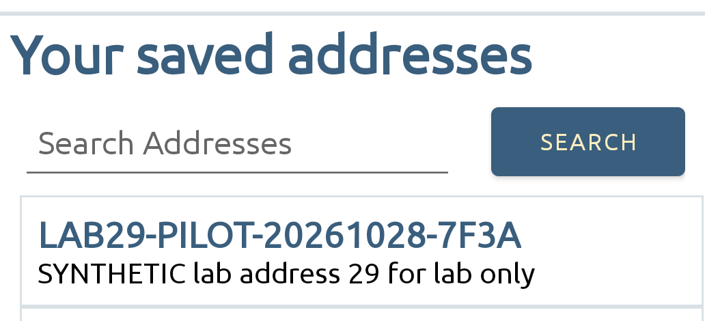
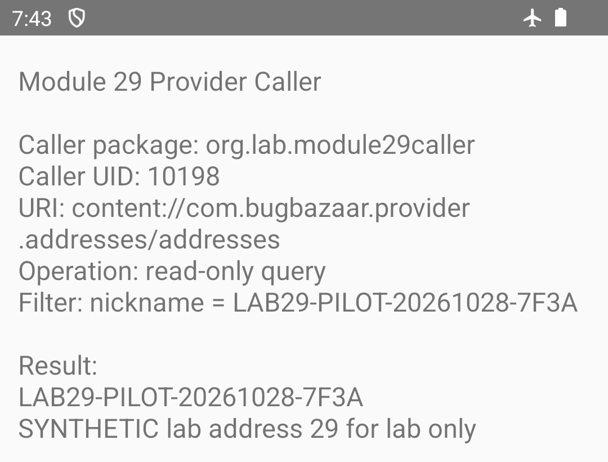

# 29 — Android Components

*Can a separate app read a fake address from BugBazaar?*

## What this lab does

You will:

1. Find or add one fake address with a unique nickname in BugBazaar.
2. Open the supplied Module 29 caller app. It asks BugBazaar for that exact address.
3. Check whether the caller displays the address, then compare its UID (Android's numeric app ID) with BugBazaar's UID.

If the caller displays the address and the UIDs differ, BugBazaar returned that record to a separate app. The lab tests one fake record only. It does not test real contacts or BugBazaar's other records.

**Tested target:** BugBazaar release `v1.2.1`, built from source revision [`fef6a899a684245eb70b2ab4be926f62be849ed9`](https://github.com/payatu/BugBazaar/tree/fef6a899a684245eb70b2ab4be926f62be849ed9). **Tested on:** Android 14 / API 34. The caller received the uniquely marked record.

## Before you begin

Complete [Common prerequisites](00-common-setup.md) and [BugBazaar setup](02-bugbazaar-setup.md). Install and verify BugBazaar and the prebuilt caller app before starting. Use an approved disposable emulator on the egress-restricted lab network. Do not build either app or use a personal phone, real contacts, or personal addresses.

## Tools needed

- An Android emulator with ADB access.
- Android SDK Platform Tools (`adb`) and a terminal on the host computer.
- The BugBazaar target app and the Module 29 caller app, installed as described in [BugBazaar setup](02-bugbazaar-setup.md).

The caller is a small prebuilt APK, published with this guide as [module-29-caller.apk](assets/apk/module-29-caller.apk). Its source is kept at `engineering/fixtures/module-29-caller/` in the repository; you do not need to build it.

Run ADB commands in the host terminal. Do the login, address search, and caller-screen check in the emulator. This walkthrough does not install or build apps.

## Guided walkthrough

### 1. Check the emulator and installed apps

In the host terminal, run the commands below. Replace `emulator-5554` with the serial shown for your emulator by `adb devices -l`.

```bash title="Check the emulator and installed apps"
set -euo pipefail
adb devices -l
SERIAL=emulator-5554  # Replace if your emulator has a different serial
adb -s "$SERIAL" shell getprop ro.build.version.release
adb -s "$SERIAL" shell getprop ro.build.version.sdk
adb -s "$SERIAL" shell pm path com.BugBazaar
adb -s "$SERIAL" shell pm path org.lab.module29caller
adb -s "$SERIAL" shell pm list packages -U com.BugBazaar
```

Check the output:

- `adb devices -l` lists your emulator with state `device`.
- The version commands print the Android release and API level. The tested emulator ran Android `14` / API `34`.
- Each `pm path` command prints a `package:` path.
- `pm list packages -U` prints `package:com.BugBazaar uid:<number>`.

Record BugBazaar's UID. It varies by emulator; you will compare it with the caller's UID in Step 3.

If the emulator is missing, unauthorized, or either package has no `package:` path, stop. Do not wipe or reset the emulator. Confirm its egress restrictions as described in BugBazaar setup.

### 2. Find or create the synthetic address

On the emulator:

- Open BugBazaar and sign in with the local demo account, `admin` / `BugBazaarSeccool`.
- If prompted, set a four-digit passcode for this disposable lab. These are local app credentials, not a cloud login.
- Deny unrelated SMS and storage or media permission prompts.
- Open **Addresses**, enter the nickname below in **Search Addresses**, and tap **Search**.

  - Nickname: `LAB29-20261028-7F3A`
  - Address: `SYNTHETIC lab address 29 for lab only`

Use the search result to decide what to do:

- **One match:** leave it as is and continue.
- **No matches:** use BugBazaar's add-address control to save one record with the exact nickname and address above, then search again.
- **More than one match, or values are uncertain:** stop. Do not add another copy or use provider writes to create the record.

The address list may contain fictional seed records. Keep those records out of screenshots.

!!! success "Expected"
    The Addresses screen shows exactly one card with nickname `LAB29-20261028-7F3A` and address `SYNTHETIC lab address 29 for lab only`.



### 3. Run the query from the ordinary caller app

Return to the host terminal and run this command to open **Module 29 Provider Caller** on the emulator. The caller runs its fixed, read-only query as soon as it opens; you do not need to type anything into the app.

```bash title="Open the Module 29 caller"
adb -s "$SERIAL" shell am start -n org.lab.module29caller/.MainActivity
```

On the caller screen, verify:

- Caller package is `org.lab.module29caller`.
- Caller UID is different from BugBazaar's UID recorded in Step 1.
- URI is `content://com.bugbazaar.provider.addresses/addresses`.
- Filter is the exact synthetic nickname.
- Result contains the synthetic nickname and address, with no other rows.

The supplied caller has no permissions and accepts no URI or filter input. On Android 11 and later, its `<queries>` entry makes the provider discoverable but does not grant read access. Do not use `adb shell content query` as evidence; that query runs from the ADB shell, not the ordinary caller app.

Example output (your caller UID will differ from `10198`):

```text
Caller package: org.lab.module29caller
Caller UID: 10198
URI: content://com.bugbazaar.provider.addresses/addresses
Operation: read-only query
Filter: nickname = LAB29-20261028-7F3A

Result:
LAB29-20261028-7F3A
SYNTHETIC lab address 29 for lab only
```

If the screen says `No matching row returned` or `Query failed`, stop and use Troubleshooting. Do not broaden the query.



!!! important "Key observation"
    Check that the caller's UID differs from BugBazaar's and that the ordinary caller displays the exact synthetic row. Together, these show that a separate app read this one record through the provider; an ADB shell query or access to other rows would not establish that result.

### 4. Decide what the result proves

Use these checks to write your finding:

- Confirm the caller UID differs from BugBazaar's UID from Step 1. On the tested emulator, BugBazaar's UID was `10197` and the caller's was `10198`; your numbers will vary.
- The pinned release declares the provider exported and has no read permission. If the caller returns the exact marker, report that it read this one synthetic record from a separate app.
- Limit the finding to this record. The result does not establish access to other rows, real addresses, or every component in BugBazaar.

## Troubleshooting

- **The first-run APK download prompt appears:** stop the app without continuing, verify the `isFirstRun=false` guard, and relaunch only after the read-back is correct.
- **The helper returns no matching row:** confirm BugBazaar displays the exact nickname, that both apps are installed under different UIDs, and that the helper manifest includes the provider authority under `<queries>` on Android 11+. Do not broaden the query to inspect other rows.
- **The provider reports an access error:** record the exact Android version, package versions, caller UID, URI, and error. An exported declaration does not guarantee the same runtime behavior on every Android release.
- **ADB shell returns a row but the helper does not:** that is not proof of cross-app access. Resolve the helper's package visibility and repeat the query from the ordinary app.

## Evidence

Submit these three items:

- **BugBazaar screenshot:** Show the marked fake address in BugBazaar. Keep any other address rows out of the image.
- **Caller screenshot:** Show the caller's package and UID, provider URI, exact nickname filter, and returned fake address.
- **Short note:** Record the Android version/API and the BugBazaar UID from Step 1 and caller UID from the caller screen. State whether the UIDs differ and that the caller returned only the marked fake address.

The images in this guide are examples. Capture your own screenshots, and do not include real contact information.

<details markdown="1">
<summary>Hints</summary>

1. Compare the provider's `exported` and permission attributes with the caller's package and UID.
2. Android package visibility and Android component permissions are separate controls. The helper's `<queries>` entry makes the named authority discoverable; it does not grant access.
3. Use a parameterized exact-marker selection. Never query real contacts or unrelated rows for this exercise.

</details>

## Vulnerability and Impact

BugBazaar's address provider is exported without a read permission. On Android 14 / API 34, a separate caller with a different UID read the marked synthetic address.

This confirms access to that one synthetic record. It does not show access to other rows, real addresses, or every component in BugBazaar.

## Cleanup and review

The app has no address-delete control, and the provider's `delete()` method returns `0`. No safe way to remove the row has been verified.

- Leave the synthetic record on the disposable emulator. Its nickname is `LAB29-20261028-7F3A`.
- Do not clear BugBazaar data, uninstall apps, or call provider delete.
- Dispose of the disposable emulator according to your lab policy when finished.

Which access control would prevent an unrelated app from reading these addresses? What negative test would confirm that the same caller is denied after the provider is protected?
